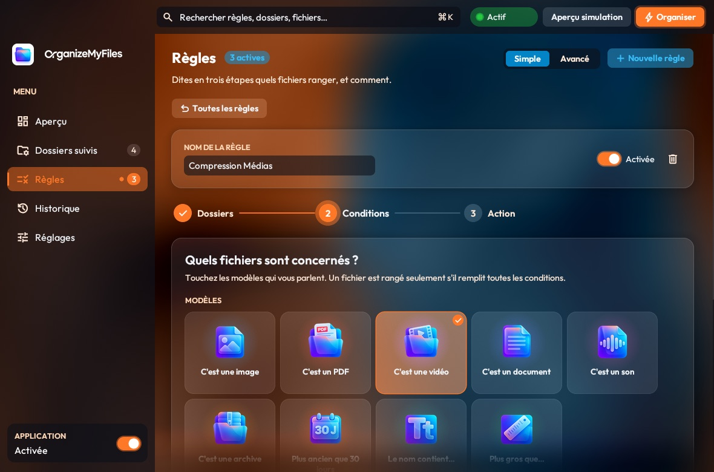

<div align="center">


**Range tes fichiers tout seul.**
Règles en trois étapes, tri par contenu, aperçu sans risque, annulation en un clic — tout reste sur ton Mac.

*Automatic file organizer for macOS: simple rules, content-aware sorting (PDF text, OCR), safe preview and undo.*

[](LICENSE)
[](https://github.com/A2com/OrganizeMyFiles/releases/latest)
[](#installation)
[](https://github.com/A2com/OrganizeMyFiles/actions/workflows/ci.yml)


</div>

## Ce que fait l'appli

- **Des règles en trois étapes** : tu choisis les dossiers, les fichiers concernés, puis ce qu'il faut en faire. Pas de syntaxe à apprendre.
- **Un tri qui lit le contenu** : extensions, nom, date, taille, mais aussi le **texte des PDF** et l'**OCR des images et des scans** (reçus, factures, courriers).
- **Des actions utiles** : déplacer, copier, renommer avec un motif, compresser en ZIP, mettre à la corbeille, ajouter un tag macOS, lancer un raccourci.
- **Aperçu sans rien toucher** : « Tester sans rien toucher » montre ce qui serait rangé, fichier par fichier.
- **Annulation en un clic** : chaque passage est un lot, que tu peux défaire entièrement.
- **Surveillance des dossiers** : un fichier arrive, il est rangé — avec un délai pour ne pas attraper les téléchargements en cours.
- **Historique** filtrable, lots repliables, recherche.
- **Discret** : barre des menus, notification, démarrage à l'ouverture de session, thème sombre.
- **Mises à jour intégrées** : l'appli prévient quand une version est publiée et vérifie son empreinte SHA-256 avant d'installer.

## Captures

<div align="center">

| Règles en mode simple | L'assistant, étape par étape |
|---|---|
|  |  |

</div>

## Installation

1. Télécharge le `.dmg` depuis la [dernière version](https://github.com/A2com/OrganizeMyFiles/releases/latest).
2. Ouvre-le, glisse **OrganizeMyFiles** sur le dossier **Applications**.
3. **Premier lancement** : clic droit sur l'appli › **Ouvrir** (l'appli n'est pas signée par un compte Apple Developer — voir [Signature](#signature)).
4. Au premier usage, autorise l'accès aux dossiers que tu veux surveiller (Bureau, Documents, Téléchargements).

**Configuration** : macOS 11 ou plus récent, Apple Silicon. Il n'y a pas encore de version Intel. Pour lire le contenu des PDF et des images, l'appli installe son petit programme d'extraction avec elle : rien d'autre à faire.

## Confidentialité

- **Tout reste sur le Mac** : les fichiers, les règles, l'historique et le journal ne sortent jamais.
- **Aucune télémétrie.** La seule connexion réseau sert à demander à GitHub si une nouvelle version existe (désactivable dans Réglages).
- Les données de l'appli vivent dans `~/Library/Application Support/OrganizeMyFiles/` (`state.json`, avec une copie `state.json.bak`) et le journal dans `~/Library/Logs/OrganizeMyFiles/` ; les deux ne sont lisibles que par ton compte.

## Compilation

Prérequis : [Rust](https://rustup.rs), macOS, Xcode Command Line Tools (pour l'outil d'extraction PDF/OCR écrit en Swift).

```bash
cd app
cargo run --release        # lance l'appli
cargo test                 # 162 tests
```

Pour fabriquer l'application et l'installateur `.dmg` (signature « ad hoc ») :

```bash
./scripts/emballer-mac.sh  # OrganizeMyFiles.app et dist/OrganizeMyFiles-X.Y.Z.dmg
```

## Signature

L'appli est signée **« ad hoc »**, sans compte Apple Developer ni notarisation : c'est un choix assumé pour un outil gratuit. Conséquences : au premier lancement, macOS demande un clic droit › Ouvrir ; et macOS ne peut pas attester l'origine de l'appli, raison pour laquelle les mises à jour vérifient obligatoirement l'empreinte SHA-256 publiée par GitHub (sans empreinte, l'installation automatique est refusée). Détails : [`docs/VERSIONNEMENT.md`](docs/VERSIONNEMENT.md).

## Licence

[MIT](LICENSE) © 2026 A2com. Les composants tiers gardent leur licence : polices Outfit et Parisienne (SIL Open Font License), Material Symbols (Apache 2.0), tracés de l'écran d'accueil générés avec Vara (MIT), sons générés avec Adobe Firefly (conditions Adobe, cf. `assets/sounds/LICENCES.md`).
